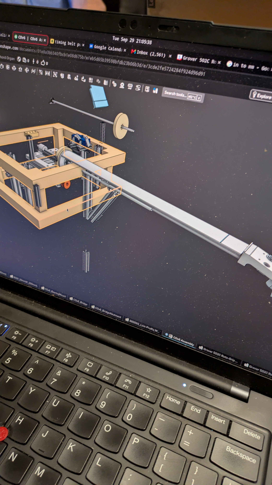

# Chord Organ journal

Edit entries directly in `index.html`, inside `<article id="journal">`.
No Markdown conversion or build step is needed. `Blog.md` has been deleted;
the old `build.py` is obsolete and should not be run.

Keep newer entries above older entries. Use `<h2>` for each entry date and
`<p>...</p>` for each paragraph. First lines are automatically indented by 2em
in `styles.css`; headings, lists, and photo captions are not indented.

```html
<h2>November 9, 2026</h2>
<p>Journal text goes here.</p>
<p>The next paragraph goes here.</p>
<figure>
  
  <figcaption>Caption beneath the photo.</figcaption>
</figure>
```

Journal formatting lives in `styles.css`. `journal.js` controls the
Jump to Oldest button. GitHub Pages serves `index.html` directly.
